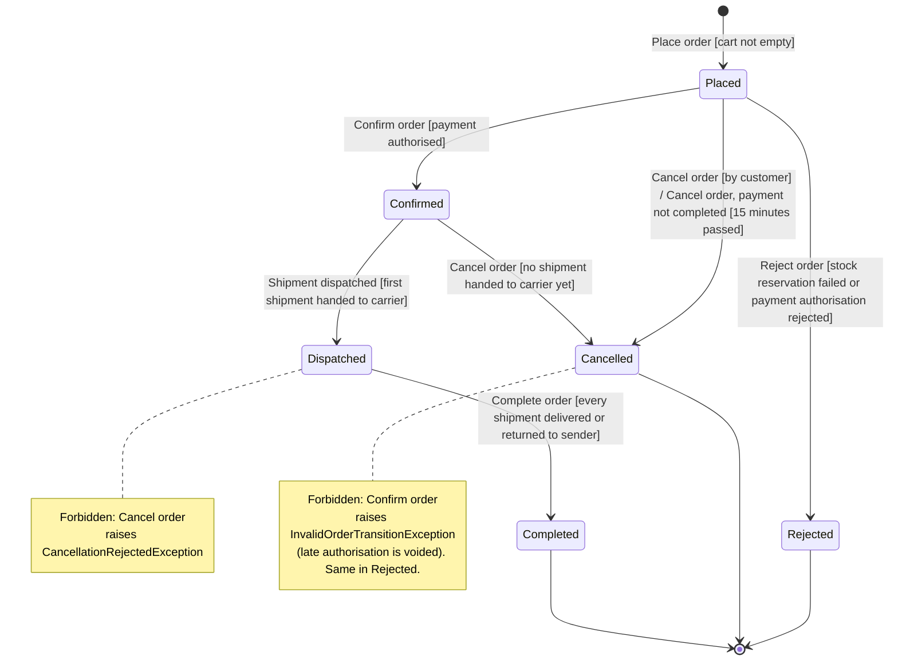
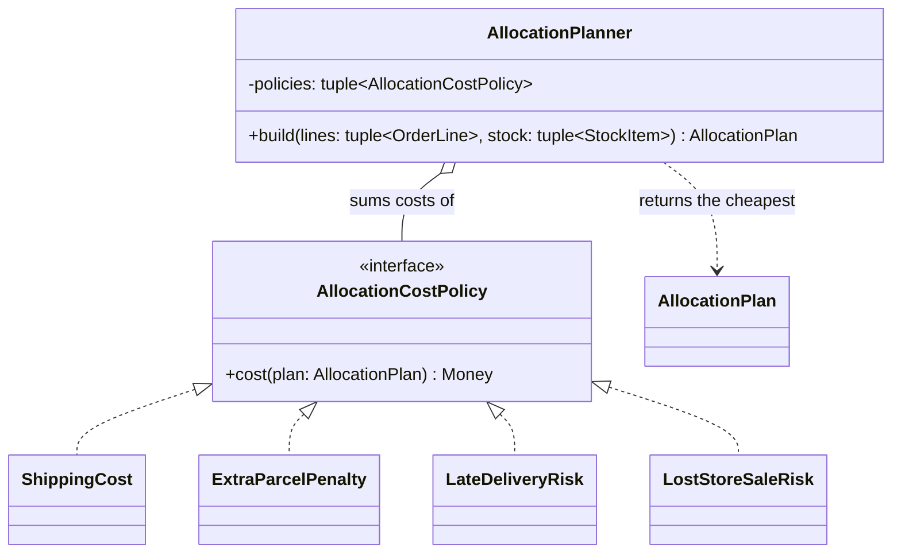

# Order lifecycle

Main aggregate: `Order` (Ordering). Value Objects are defined in [aggregates-and-invariants.md](aggregates-and-invariants.md).

## 1. State machine

`Dispatched` comes from the board decision on "Until when can an order be cancelled?": "until the first shipment is handed to the carrier".

## 2. Business invariants

| # | Aggregate | Business rule | Domain exception | Board source |
| --- | --- | --- | --- | --- |
| 1 | `Cart` | One line per `Sku`; adding the same size and colour again adds the quantities, and the sum must not exceed 5 units | `QuantityLimitExceededException` | "at most 5 units of one size and colour per order" |
| 2 | `Cart` | Only an item that is in the cart can be removed | `ItemNotInCartException` | "Removal rejected, item not in cart" |
| 3 | `Order` | An order can be placed only from a cart with at least one item | `EmptyCartException` | "Order rejected, cart is empty" |
| 4 | `Order` | An order can be cancelled only while no shipment has been handed to the carrier | `CancellationRejectedException` | "Cancellation rejected, a shipment has already left" |
| 5 | `Order` | Only a `Placed` order can be confirmed; a late payment authorisation does not revive a cancelled or rejected order | `InvalidOrderTransitionException` | "the late authorisation is voided at once and the order stays cancelled" |
| 6 | `StockItem` | Reserved units never exceed on hand minus the store safety buffer; for the last unit, the reservation saved first wins | `StockUnavailableException` | "Available online = on hand minus reserved minus the store safety buffer" |

## 3. Given–When–Then

**Positive 1** (invariant 1)
- **Given** the cart contains `DRESS-RED-M` × 2
- **When** "Add item to cart" with `DRESS-RED-M` × 3
- **Then** the cart has one line for `DRESS-RED-M` with quantity 5; event `ItemAddedToCart`

**Positive 2** (invariant 4)
- **Given** order `ord-77` is `Confirmed` and no shipment has been handed to the carrier
- **When** "Cancel order"
- **Then** the order is `Cancelled`; event `OrderCancelledByCustomer`

**Negative 1** (invariant 1)
- **Given** the cart contains `DRESS-RED-M` × 4
- **When** "Add item to cart" with `DRESS-RED-M` × 2
- **Then** `QuantityLimitExceededException`; the line keeps quantity 4

**Negative 2** (invariant 4, forbidden transition)
- **Given** order `ord-78` is `Dispatched`
- **When** "Cancel order"
- **Then** `CancellationRejectedException`; the order stays `Dispatched`

## 4. Design pattern: Strategy (Policy)

Board decision for "One slow parcel or several fast ones?": "the plan with the lowest total cost wins: shipping + penalty per extra parcel + late-delivery risk + risk of losing a store sale" (command "Build allocation plan", Inventory). Each cost part is one policy; `AllocationPlanner` sums them for every candidate plan and picks the cheapest. A new cost rule is a new class, and the planner does not change.

